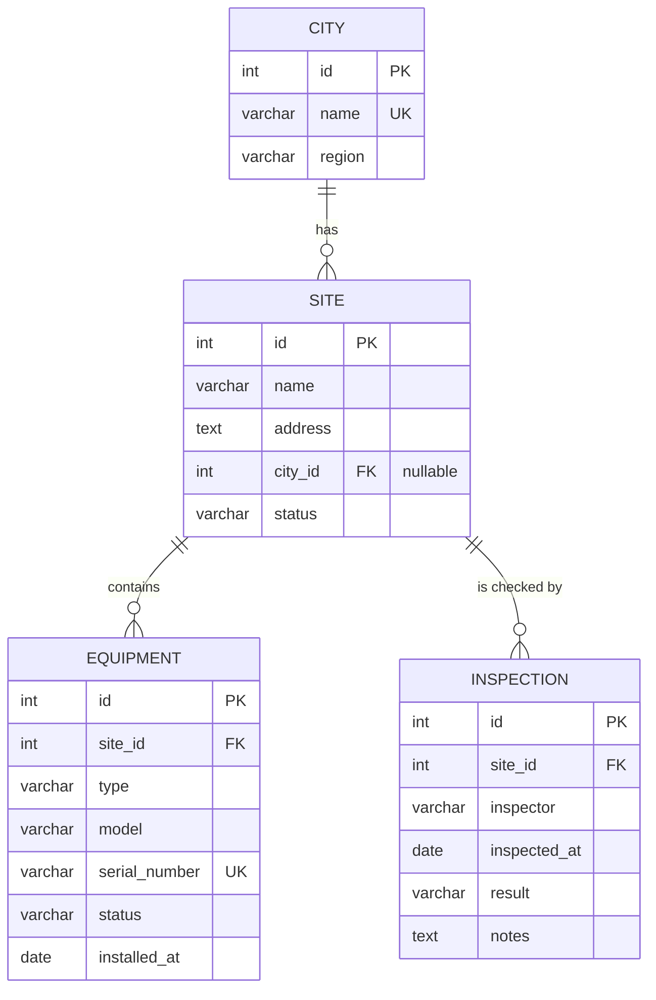

# Site-Tracker

A REST API for tracking telecom sites, the equipment installed on them and their inspections. Light version of the CIP Tracker work project, built as a containerized backend with a PostgreSQL database.

## Tech stack

- Node.js 20 + Express 5
- PostgreSQL 16, accessed through **TypeORM** (schema managed by migrations)
- zod for request validation
- Docker and Docker Compose

## Data model



Three one-to-many relationships: city → sites, site → equipment, site → inspections.

## Run

Requires Docker with Compose.

```bash
cp .env.example .env
docker compose up --build
```

The API is available at `http://localhost:3000`. Check it:

```bash
curl http://localhost:3000/health
curl http://localhost:3000/api/sites
curl http://localhost:3000/api/stats/overview
```

On start the backend applies the database migrations (`backend/src/migrations`) and, when the database is empty and `SEED_ON_START=true`, inserts sample data (4 cities, 5 sites with equipment and inspections — the first site is still the original *Central Tower* sample row).

Stop with `docker compose down`. Data is kept in the named volume `pgdata`; use `docker compose down -v` to delete it and start fresh.

### Without Docker

```bash
cd backend
npm install
# needs a running PostgreSQL; set DB_HOST/DB_PORT/DB_USER/DB_PASSWORD/DB_NAME (defaults: localhost, 5432, postgres, postgres, site_tracker)
npm run migration:run     # create the tables
npm run seed              # optional: wipe the tables and insert sample data
npm run dev               # nodemon, http://localhost:3000
```

| Script (in `backend/`) | What it does |
|---|---|
| `npm start` / `npm run dev` | run the API / run with auto-reload |
| `npm run migration:run` | apply migrations (the server also does this on start) |
| `npm run migration:revert` | undo the last migration |
| `npm run migration:generate -- src/migrations/Name` | generate a migration from entity changes |
| `npm run seed` | **reset** all tables and insert sample data |
| `npm run test:api` | run the Postman collection with Newman (API must be running) |

## Configuration

All configuration comes from environment variables in `.env` (template: `.env.example`).

| Variable | Description | Default in template |
|---|---|---|
| `PORT` | Port the API listens on (also published on the host) | `3000` |
| `DB_USER` | Postgres user | `postgres` |
| `DB_PASSWORD` | Postgres password | `postgres` |
| `DB_NAME` | Database name | `site_tracker` |
| `DB_PORT` | Postgres port inside the Docker network | `5432` |
| `SEED_ON_START` | Insert sample data on start if the database is empty | `true` |

The backend reaches the database at host `db` (the compose service name) over the `app-net` network.

## Project structure

```
.
├── backend/
│   ├── Dockerfile
│   └── src/
│       ├── index.js         # start-up: connect, migrate, seed, listen
│       ├── app.js           # Express app: middleware, /health, /api
│       ├── data-source.js   # TypeORM DataSource
│       ├── constants.js     # allowed statuses / types / results
│       ├── entities/        # City, Site, Equipment, Inspection
│       ├── migrations/      # database schema
│       ├── schemas/         # zod validation schemas
│       ├── middleware/      # validation + error handling
│       ├── routes/          # /api routes (cities, sites, equipment, inspections, stats)
│       ├── utils/httpError.js
│       └── seed.js          # sample data
├── docs/API.md              # API documentation
├── postman/                 # Postman collection
├── docker-compose.yml
└── .env.example
```

## What changed since the midterm version

- `pg` queries were replaced with TypeORM; `init.sql` was replaced with migrations (the table now also has `updated_at`, and a database `CHECK` on `status`).
- `city` became its own table (`sites.city_id`) instead of a text column; `equipment` and `inspections` were added.
- JSON field names are now camelCase (`createdAt`, not `created_at`).
- List endpoints return `{ data, meta }` with paging, and errors use one shape: `{ error: { status, code, message, details? } }`.

## Documentation

- API reference: [docs/API.md](docs/API.md)
- Postman collection: [postman/site-tracker.postman_collection.json](postman/site-tracker.postman_collection.json). Import it in Postman and run the collection top to bottom (the collection variable `baseUrl` defaults to `http://localhost:3000`). It creates its own data, stores the ids in collection variables and deletes everything at the end, so it can be run repeatedly. Every request has tests: 59 requests, 125 assertions.
